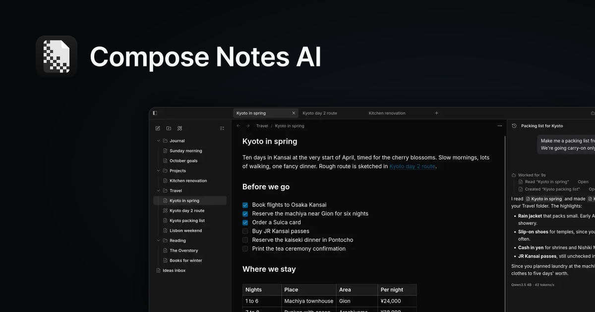

# Compose Notes AI

<p align="center">
  <a href="https://www.composenotesai.com">
    
  </a>
</p>

Your notes, composed with local AI agents. Write and organize your notes, then ask the AI about them. It runs on your device and stays completely private.

Notes are stored in one compressed SQLite database on your machine, and the AI runs on a locally hosted model. No account, no tracking, and it works offline. For Linux, Windows and macOS.

[Website](https://www.composenotesai.com) · [Download](https://github.com/dtr00/composenotesai/releases/latest)

## Features

- **Markdown that stays out of the way.** A clean, fast editor for everything from quick thoughts to long documents. Organize notes in folders and link them together.
- **Ask your notes anything.** The AI sits beside every note. It answers from your own writing, drafts and edits text, and every change can be undone. It searches your library and reads only what it needs.
- **Runs on your machine.** A llama.cpp engine the app sets up, or Ollama and other compatible servers. Web search is available and stays off until you turn it on.
- **Sketch next to your notes.** Draw diagrams and sketches with Excalidraw right alongside your notes. Drawings live in the same folders.
- **Dictate from anywhere.** Say it out loud and it becomes a note, from anywhere on your computer.
- **Small on purpose.** Your notes take up almost no space, and the app stays light. AI and speech models download from inside the app when you choose to use them.
- **Yours to customize.** Make the app look and work the way you like, down to how the AI answers.

Built with Tauri 2, Vite, React and TypeScript. The repository is a Bun workspaces monorepo holding the desktop app (`apps/desktop/`) and the website (`apps/web/`); see [Repository architecture](docs/architecture.md).

## Development

Requires [Bun](https://bun.sh) and [Rust](https://rustup.rs), plus the [Tauri prerequisites](https://tauri.app/start/prerequisites/) for your OS.

```sh
bun install
bun run dev:desktop
```

To run the dev server on another port (the default is 1420), for example next to an instance that is already running:

```sh
bun run dev:desktop --port=3000
```

## Website

The website is a TanStack Start app in `apps/web/`:

```sh
bun run web dev
```

## Excalidraw

Choose **New Excalidraw note** from the sidebar, new tab, or a folder's menu. Drawings start as `Untitled excalidraw note`, then `Untitled excalidraw note 1`, and so on.

Excalidraw comes with the app. Its editor and fonts work offline immediately, and drawings stay in the notes database.

AI agents can create, read, edit and duplicate drawings through the app's JSON command-line interface. See [Excalidraw and agent access](docs/excalidraw.md).

## Building

```sh
bun run tauri build
```

Linux produces `.deb` and AppImage packages; Windows and macOS use their default installers.

Releases are automatic: merging desktop changes to `main` bumps the version from the commit messages (Conventional Commits) and publishes the app. See [Releases](docs/architecture.md#releases).
